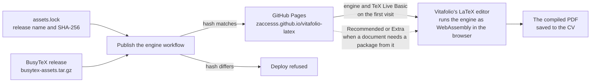

# Vitafolio LaTeX engine

Hosts the files [Vitafolio](https://vitafolio.isaacadjei.me) downloads to compile LaTeX CVs in the
browser. Nothing is compiled on a server: the engine runs as WebAssembly in each visitor's browser,
which caches the files after the first download.

The site is <https://zaccesss.github.io/vitafolio-latex/>.

## What is published

| Path | What it is | Size |
| --- | --- | --- |
| `busytex/busytex.wasm`, `busytex/*.js` | The [BusyTeX](https://github.com/TeXlyre/texlyre-busytex) engine and its loaders | About 32 MB |
| `busytex/texlive-basic.*` | TeX Live Basic | About 90 MB |
| `busytex/texlive-recommended.*` | TeX Live Recommended | About 190 MB |
| `busytex/texlive-extra.*` | TeX Live Extra | About 330 MB |
| `busytex/biber.*` | Biber, for bibliographies | About 30 MB |

The editor loads the engine and TeX Live Basic up front, about 120 MB on the first visit, which
covers every starter template. Recommended and Extra are listed as a catalogue: a document that uses
one of their packages downloads that collection when it first compiles. The browser keeps every file
it has downloaded.

## How it works

The engine files are too large for git: two are over 100 MB. The repository holds only
[`assets.lock`](assets.lock), which names the release and its SHA-256. The
[Publish the engine](.github/workflows/pages.yml) workflow downloads that release from the BusyTeX
project, refuses to continue if the hash differs, unpacks it and deploys it to GitHub Pages. Pages
sends `Access-Control-Allow-Origin: *`, which the browser needs to load the files from Vitafolio.

> [!IMPORTANT]
> The version in `assets.lock` must match the `texlyre-busytex` version in Vitafolio's
> `package.json`. The JavaScript loader and the WebAssembly files are built together, so a mismatch
> stops compiling.

## Updating the engine

1. Bump `texlyre-busytex` in Vitafolio.
2. Download `busytex-assets.tar.gz` from the matching `assets-vX.Y.Z` release and run
   `shasum -a 256` on it.
3. Put the version and hash in `assets.lock` and open a pull request. The site republishes on merge.

## Licences

This repository's own files are under the [MIT licence](LICENSE). The engine and TeX Live packages it
publishes keep their own licences, listed in [NOTICE.md](NOTICE.md).
